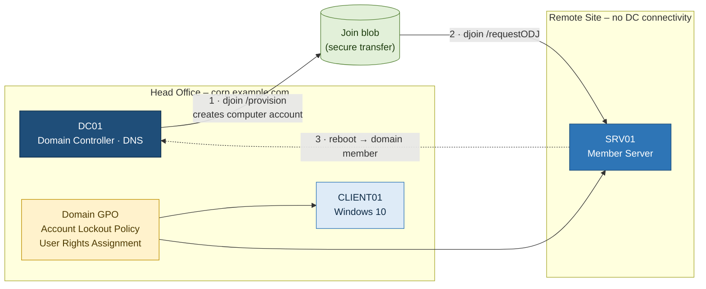

# 01 – Offline Domain Join & Account Auditing

**Windows Server · Active Directory · PowerShell**

## Scenario

A company is building a server for a site that has no network path to a domain controller yet. It must arrive already joined to `corp.example.com`. At the same time the helpdesk wants better control over account security: lock out password-guessing attempts, find locked and stale accounts quickly, and limit who may sign in to servers locally or over RDP.

## Solution Architecture

### Components

| Component | Role |
|---|---|
| **DC01** | Domain controller and DNS for `corp.example.com`; provisions the computer account |
| **SRV01** | Target server joined **offline**, with no network path to a DC during the join |
| **CLIENT01** | Windows 10 workstation used to test the lockout policy and sign-in rights |
| **Domain GPO** | Account lockout threshold, *Allow log on locally*, *Allow log on through RDS* |

### Design Decisions

| Decision | Rationale |
|---|---|
| Offline Domain Join instead of a standard join | The site has no line-of-sight to a DC. ODJ lets the device arrive already joined |
| Delete the stale computer object before re-provisioning | Avoids name/SID conflicts and broken secure channels |
| Treat the join blob as a credential | It contains the machine account password, so delete it after use |
| Lockout policy at **domain** level | Account policies only take effect from a domain-linked GPO |
| RDP access through a security group | Least privilege: access is granted and removed by group membership, not per user |

## What I Practised

- Pre-creating a computer account and join blob with `djoin /provision`
- Applying the blob on the target with `djoin /requestODJ`, with no DC contact needed
- Cleaning up stale computer objects before re-provisioning
- Setting an **account lockout policy** and checking it from a client
- Finding **locked**, **disabled** and **inactive** accounts with `Search-ADAccount`, and unlocking them
- Restricting **Allow log on locally** and **Allow log on through Remote Desktop Services**

## Why It Matters

| Real-world situation | Technique |
|---|---|
| Building devices at HQ for remote or offline sites | Offline Domain Join |
| "I'm locked out" tickets | `Search-ADAccount -LockedOut \| Unlock-ADAccount` |
| Access reviews / leaver clean-up | Disabled and inactive account reports |
| Limiting who can RDP to servers | User Rights Assignment + Remote Desktop Users |

## Files

| File | Description |
|---|---|
| [`lab_summary.md`](lab_summary.md) | Walkthrough of my lab build, with a screenshot for every step |
| [`screenshots/`](screenshots/) | Lab evidence (identifiers blurred) |
| [`runbook.md`](runbook.md) | Step-by-step procedure with generic names |
| [`scripts/offline-domain-join.cmd`](scripts/offline-domain-join.cmd) | djoin provisioning and apply |
| [`scripts/account-audit.ps1`](scripts/account-audit.ps1) | Locked, disabled and inactive account report |
| [`troubleshooting.md`](troubleshooting.md) | Common failures and fixes |

## What I Learned

- An offline join has two halves, **provision** (on a DC) and **apply** (on the target), and only takes effect after a reboot.
- The join blob contains the machine account password, so treat it like a credential.
- RDP access needs **both** the user right and membership of Remote Desktop Users.
- PowerShell account reports are much faster than browsing ADUC, and you can schedule them.
