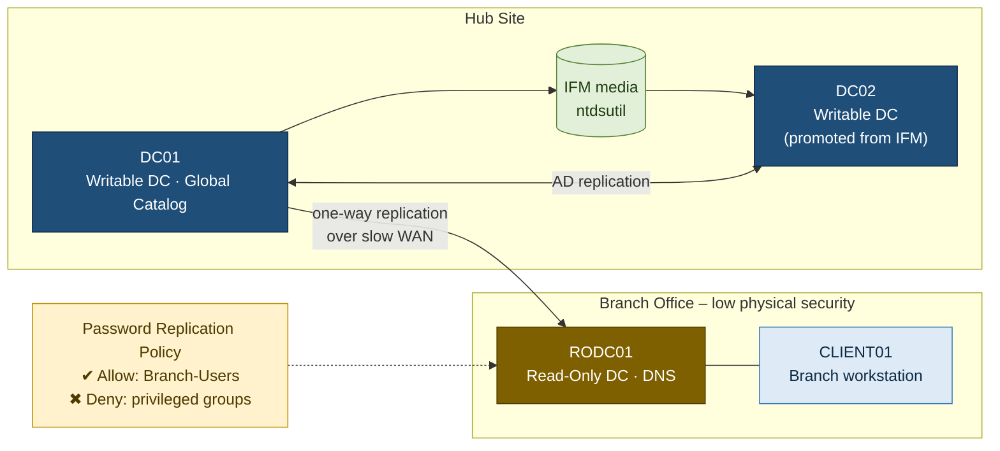

# 02 – DC Deployment with IFM & a Read-Only DC

**Windows Server · AD DS · PowerShell**

## Scenario

`corp.example.com` is opening a branch office connected over a slow WAN link. The server room there isn't physically secure. The business needs:

1. A second **writable DC** at a hub site, built without pulling the whole directory over the network.
2. A **Read-Only DC** at the branch that caches passwords only for branch staff, so a stolen server exposes as little as possible.

## Solution Architecture

### Components

| Component | Role |
|---|---|
| **DC01** | Existing writable DC and Global Catalog; the source of the IFM media |
| **DC02** | Additional writable DC, promoted from IFM so it doesn't need a full initial replication |
| **RODC01** | Read-Only DC at the branch: no writable directory, and it caches approved passwords only |
| **Branch-Users** | Security group of branch users and computers allowed to be cached on the RODC |

### Design Decisions

| Decision | Rationale |
|---|---|
| Install From Media for DC02 | Cuts initial replication traffic. Only changes since the media was made cross the network |
| RODC at the branch, not a writable DC | If the server is stolen, little is exposed: no writable copy of AD, and only limited cached credentials |
| Allow-list a single branch group | By default an RODC caches nothing, so only named users and computers are approved |
| Keep the built-in **Deny** groups | Deny overrides Allow, so admin credentials are never cached at the branch |
| Prepopulate passwords | Branch users can sign in even when the WAN link is down |

## What I Practised

- Creating **Install From Media** with `ntdsutil` (`ifm` → `create sysvol full`)
- Promoting a DC from media in the AD DS Configuration Wizard
- Promoting an **RODC** with `Install-ADDSDomainController -ReadOnlyReplica`
- Setting up the **Password Replication Policy** (PRP): an *allow* group, the built-in *deny* groups, prepopulating passwords
- Checking which accounts are cached on the RODC with **Advanced Password Replication Policy**

## Why It Matters

| Real-world situation | Technique |
|---|---|
| New DC across a slow link | IFM cuts initial replication |
| Server at a site that isn't secure | RODC: no writable AD and limited cached secrets |
| Branch staff must sign in when the WAN is down | PRP allow group + prepopulated passwords |
| Admin credentials must never be on branch servers | Denied RODC Password Replication Group |
| Responding to a stolen RODC | Report of cached accounts → reset those passwords |

## Files

| File | Description |
|---|---|
| [`lab_summary.md`](lab_summary.md) | Walkthrough of my lab build, with a screenshot for every step |
| [`screenshots/`](screenshots/) | Lab evidence (identifiers blurred) |
| [`runbook.md`](runbook.md) | Step-by-step procedure with generic names |
| [`scripts/create-ifm.cmd`](scripts/create-ifm.cmd) | IFM creation |
| [`scripts/deploy-rodc.ps1`](scripts/deploy-rodc.ps1) | RODC promotion and PRP setup |
| [`troubleshooting.md`](troubleshooting.md) | Common failures and fixes |

## What I Learned

- After an IFM promotion, the new DC only has to replicate the changes made **since** the media was created.
- By default an RODC caches **nothing**, so allowing a group is a deliberate choice.
- A **Deny** entry always beats **Allow**, which keeps privileged accounts off the RODC even if someone adds them to an allow group by mistake.
- Keep the cached-accounts report: if an RODC is stolen, it lists exactly whose passwords to reset.
