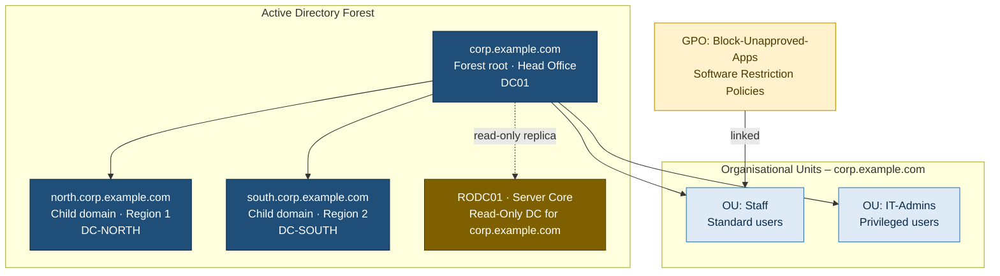

# 03 – Multi-Domain Forest & Group Policy

**Windows Server · AD DS · Group Policy · Hyper-V**

## Scenario

An organisation with a head office and two regional offices wants:
- One AD **forest**, with a **child domain** per region so each region has its own admin boundary
- A **Read-Only DC on Server Core** for a small, less secure site
- An OU structure separating standard staff from IT admins
- Group Policy that **blocks unapproved applications** for standard staff but not for IT

## Solution Architecture

### Components

| Component | Role |
|---|---|
| **corp.example.com** | Forest root domain at head office; holds the Enterprise Admins and the schema |
| **north / south** | Child domains, each giving a region its own administrative boundary |
| **RODC01** | Server Core read-only DC for a small site with weak physical security |
| **Staff / IT-Admins OUs** | Separate standard and privileged accounts so policy can target each group |
| **Block-Unapproved-Apps GPO** | Software Restriction path rules for unapproved desktop and Store apps |

### Design Decisions

| Decision | Rationale |
|---|---|
| Single forest, one child domain per region | Regional admin separation with a shared schema, Global Catalog and trusts |
| RODC on Server Core | Smaller attack surface and patch footprint at the least secure site |
| GPO linked at the **Staff OU**, not the domain | Scopes restrictions to standard users. Admins stay unaffected |
| Path rules that include `WindowsApps` | Store apps install outside `Program Files`, so they need their own rules |
| Verify with `gpresult /r` | Shows which GPOs actually reached each user, not just what was configured |

## What I Practised

- Building a forest root with `Install-ADDSForest`
- Adding child domains with `Install-ADDSDomain -DomainType ChildDomain`
- Promoting a **Server Core** machine to an RODC entirely from PowerShell
- Creating OUs and users with different password options, and assigning a privileged group
- Building a GPO with **Software Restriction Policies** (path rules) that block a desktop app and a Store app
- Scoping a GPO by **where it is linked**, and proving the result with `gpresult /r`

## Why It Matters

| Real-world situation | Technique |
|---|---|
| Several regions with separate IT teams | Child domains in one forest |
| Small site with no secure server room | RODC on Server Core |
| Different rules for staff and admins | OUs + GPO linked to one OU |
| Stopping unapproved software | Software Restriction / AppLocker path rules |
| "Why didn't my policy apply?" tickets | `gpresult /r`, `gpupdate /force` |

## Files

| File | Description |
|---|---|
| [`lab_summary.md`](lab_summary.md) | Walkthrough of my lab build, with a screenshot for every step |
| [`screenshots/`](screenshots/) | Lab evidence (identifiers blurred) |
| [`runbook.md`](runbook.md) | Step-by-step build and configuration with generic names |
| [`scripts/build-forest.ps1`](scripts/build-forest.ps1) | Forest root, child domain and RODC commands |
| [`scripts/ou-users-groups.ps1`](scripts/ou-users-groups.ps1) | OU, user and group creation |
| [`troubleshooting.md`](troubleshooting.md) | Common failures and fixes |

## What I Learned

- Child domains share one schema, configuration and Global Catalog. They separate administration, not security, because the forest is the real security boundary.
- Server Core is a good fit for an RODC: it has a smaller attack surface and fewer patches.
- **Where** a GPO is linked decides who gets it. Users outside the linked OU aren't affected.
- Store apps live under `C:\Program Files\WindowsApps\`, so path rules have to point there, not at a classic `.exe` path.
- `gpresult /r` is the quickest way to see which GPOs actually reached a user, and which were filtered out.
