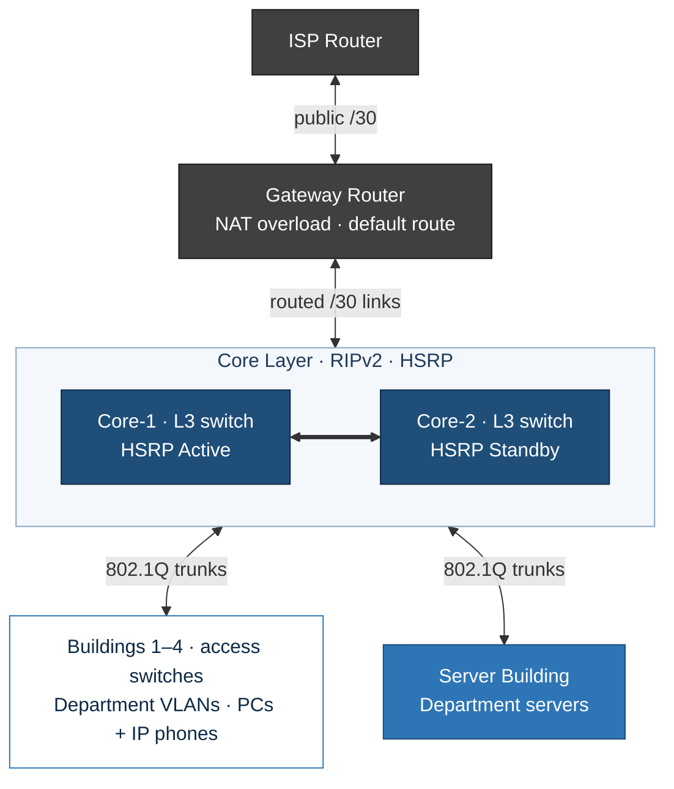

# 01 – Multi-Building Campus Network

**Cisco Packet Tracer · VLANs · HSRP · RIPv2 · NAT**

## Scenario

A campus has five departments spread over several buildings, with PCs and IP phones in each one and a server room holding one server per department. The network must:

- Keep departments in **separate VLANs and subnets**, even when they share a building
- Use the address space efficiently, sizing **each subnet to its host count**
- Keep working if **one core switch fails**
- Give every department internet access through a **single public address**

## Solution Architecture

### Addressing Summary (example scheme)

| Segment | VLAN | Prefix | Gateway (HSRP VIP) |
|---|---|---|---|
| Department 1 (largest) | 10 | 10.20.0.0/24 | 10.20.0.1 |
| Department 2 | 20 | 10.20.1.0/25 | 10.20.1.1 |
| Department 3 | 30 | 10.20.1.128/25 | 10.20.1.129 |
| Department 4 | 40 | 10.20.2.0/26 | 10.20.2.1 |
| Department 5 (smallest) | 50 | 10.20.2.64/27 | 10.20.2.65 |
| Core ↔ Gateway links | – | 10.20.2.96/30, 10.20.2.100/30 | – |
| Gateway ↔ ISP | – | 203.0.113.0/30 | – |

The full VLSM worksheet is in the [runbook](runbook.md#1-vlsm-plan).

### Design Decisions

| Decision | Rationale |
|---|---|
| One VLAN and subnet per department | Smaller broadcast domains and a clear policy boundary |
| VLSM, largest subnet first | No wasted space. Each subnet is sized to its host count |
| Dual Layer 3 cores with HSRP | Removes the default gateway as a single point of failure |
| Every access switch trunks to **both** cores | Any building survives the loss of one core |
| RIPv2 with `no auto-summary` | Simple dynamic routing that keeps VLSM subnets intact |
| PAT at the edge | The whole campus shares one public address |

## What I Practised

- **VLSM:** sizing subnets from largest to smallest host requirement
- Creating VLANs, **access ports** and **802.1Q trunks** on 2960 access switches
- **Inter-VLAN routing** with SVIs on Layer 3 switches (`ip routing`)
- **HSRP** per VLAN, with priorities and preemption, for a redundant default gateway
- **RIPv2** between the core switches and the gateway router
- **NAT overload (PAT)** at the edge to the ISP
- Testing intra-VLAN, inter-VLAN, edge and internet reachability, then **failing a core switch** to prove HSRP works

## Why It Matters

| Real-world need | Technique |
|---|---|
| Separate departments for security and broadcast control | VLANs + one subnet per VLAN |
| Don't waste address space | VLSM |
| No single point of failure at the gateway | HSRP on two L3 switches |
| Many users, one public IP | NAT overload / PAT |

## Files

| File | Description |
|---|---|
| [`lab_summary.md`](lab_summary.md) | Walkthrough of my build with screenshots |
| [`screenshots/`](screenshots/) | Topology and verification evidence |
| [`runbook.md`](runbook.md) | VLSM plan and build steps (example addressing) |
| [`configs/`](configs/) | Reference configs for the access switch, core switches, gateway and ISP |
| [`troubleshooting.md`](troubleshooting.md) | Common pitfalls and fixes |

## What I Learned

- The HSRP **virtual IP must be different** from each switch's own SVI address. Hosts point at the virtual IP.
- Turn off RIPv2 `auto-summary`, otherwise subnets of the same major network get summarised and routes break.
- In NAT, the `inside` and `outside` interface roles matter as much as the ACL that matches the traffic.
- The first ping after a change often loses one packet while ARP resolves. That's normal, not a fault.
