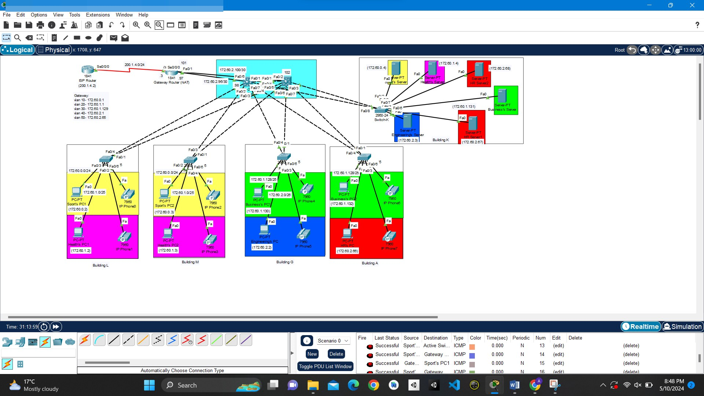
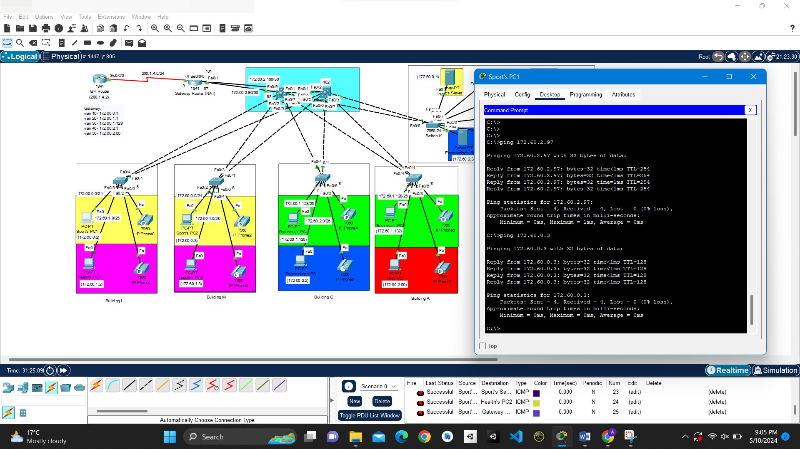
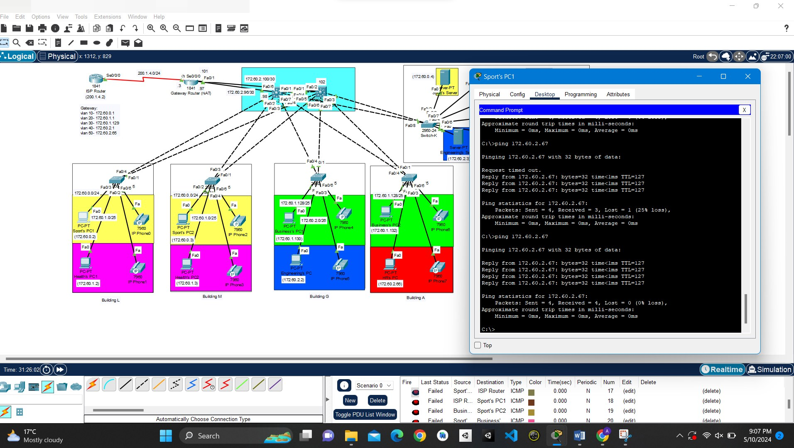
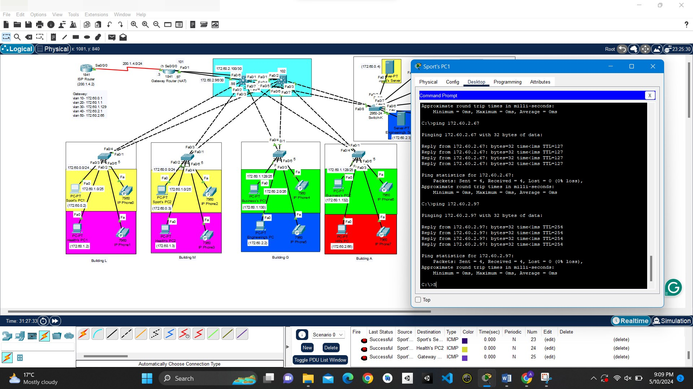
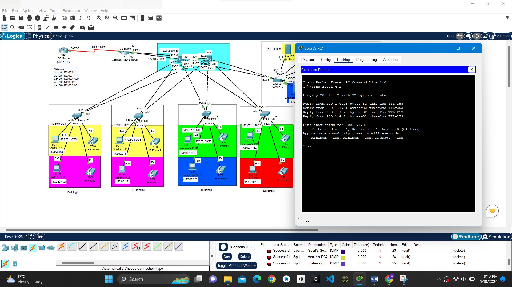
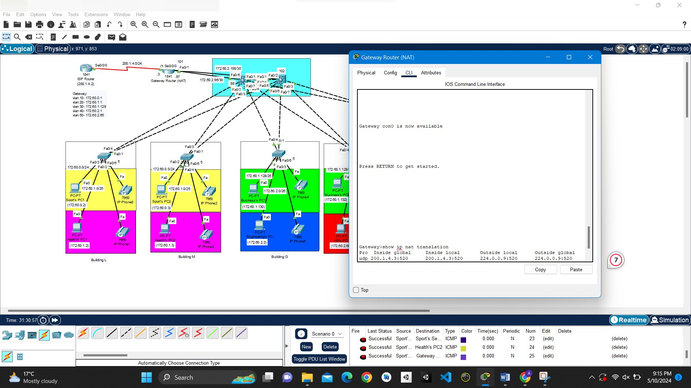
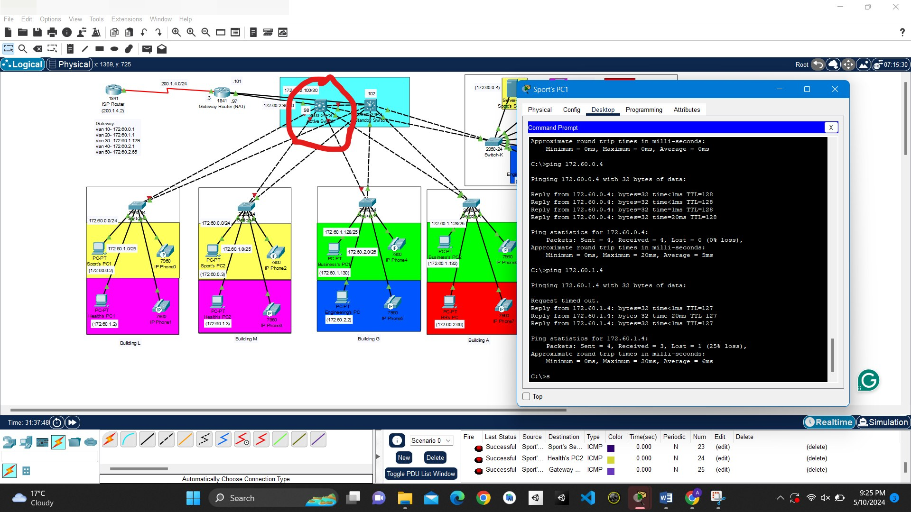

# Lab Summary – Multi-Building Campus Network (VLANs, HSRP, RIPv2, NAT)

I designed and built a campus network in Cisco Packet Tracer covering five departments spread across several buildings. The access switches in each building trunk VLANs up to a pair of Layer 3 core switches running **HSRP**, so the default gateway stays up if one core fails. The core routes with **RIPv2** to a gateway router, which uses **NAT overload (PAT)** to reach the ISP. Address space was split with **VLSM**, sizing each subnet to its department's host count.

> Screenshots are from my own Packet Tracer build. Identifying details (file paths, student and course identifiers) are blurred.

---

## Topology

### Figure 1.1: Campus Topology with Subnets & Addressing
**Device:** `Packet Tracer`

The full design: four buildings, each with a 2960 access switch and colour-coded department VLANs (PCs and IP phones). There's a server building (Building K) with a server per department, two Layer 3 core switches joined by an EtherChannel-style link, a gateway router doing NAT, and the ISP router. Every subnet, gateway and point-to-point /30 link is labelled.

---

## Verification

### Figure 2.1: Ping Within the Same VLAN
**Device:** `Department PC`

A PC pings a host in its own VLAN in another building, proving the 802.1Q trunks carry the VLAN across the access switches.

### Figure 2.2: Ping Between VLANs
**Device:** `Department PC`

A ping to a PC in a different department succeeds, so inter-VLAN routing on the Layer 3 core SVIs is working. The first reply times out while ARP resolves.

### Figure 2.3: Ping to the Gateway Router
**Device:** `Department PC`

The PC reaches the gateway router's interfaces, which confirms the routed /30 uplinks and the RIPv2 routes.

### Figure 2.4: Ping to the ISP Router
**Device:** `Department PC`

A ping out to the ISP router succeeds, so traffic goes all the way through the edge.

### Figure 2.5: NAT Translation Table
**Device:** `Gateway Router`

`show ip nat translations` on the gateway shows inside-local private addresses translated to the router's outside interface (PAT/overload).

### Figure 2.6: Core Switch Failover (HSRP)
**Device:** `Department PC`

I took one Layer 3 core switch out of service (circled) and pinged again. After a brief drop while the standby router became active, replies resumed, so HSRP failover works.

