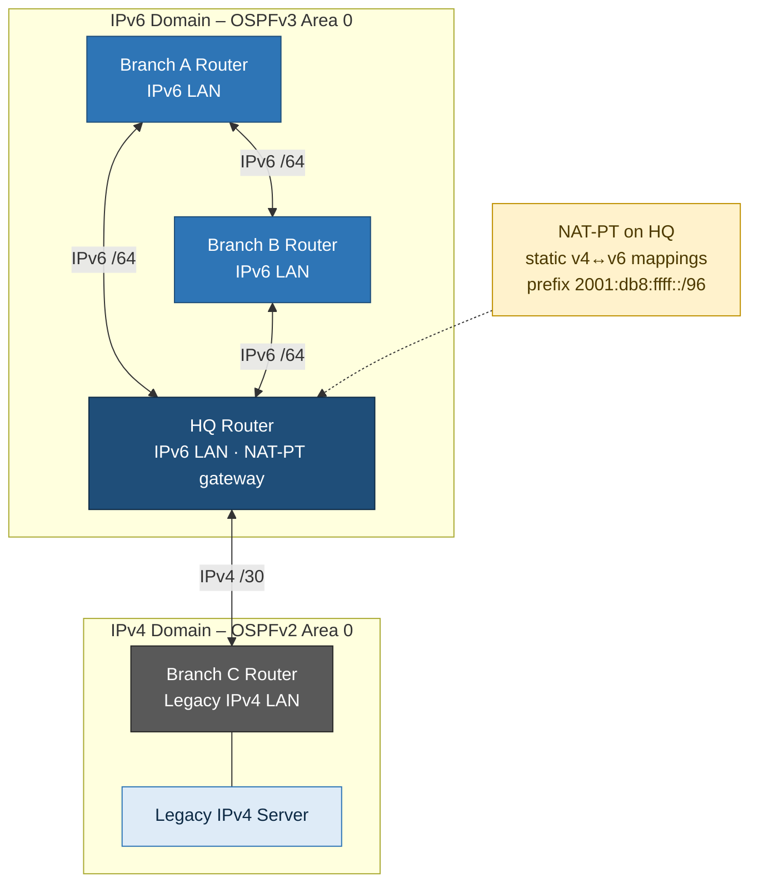

# 02 – IPv6 Migration with OSPFv3 & NAT-PT

**Cisco Packet Tracer · IPv6 · OSPFv2 / OSPFv3 · NAT-PT**

## Scenario

A company is moving to IPv6. HQ and two branches have been rebuilt as **IPv6-only**, but one legacy branch still runs **IPv4**, including a server everyone needs. The network must:

- Split one IPv6 allocation into subnets for every LAN and WAN link
- Route IPv6 between HQ and the IPv6 branches, and IPv4 between HQ and the legacy branch
- Let IPv6 hosts reach the IPv4 server, and IPv4 hosts reach HQ, **without dual-stacking every host**

## Solution Architecture

### Addressing Summary (example scheme)

| Network | Prefix |
|---|---|
| HQ LAN | 2001:db8:acad:1::/64 |
| Branch A LAN | 2001:db8:acad:2::/64 |
| Branch B LAN | 2001:db8:acad:3::/64 |
| HQ ↔ A / HQ ↔ B / A ↔ B | 2001:db8:acad:12::/64 · :13::/64 · :23::/64 |
| NAT-PT prefix | 2001:db8:ffff::/96 |
| Branch C LAN (IPv4) | 198.51.100.0/25 |
| HQ ↔ Branch C (IPv4) | 198.51.100.128/30 |

### Design Decisions

| Decision | Rationale |
|---|---|
| A /64 per network, site ID in the 4th hextet | Standard IPv6 practice: SLAAC-compatible and easy to read and summarise |
| Full-mesh triangle between HQ, A and B | Any single WAN link can fail without isolating a site |
| OSPFv3 for IPv6, OSPFv2 for IPv4 | Same protocol family and operating model on both stacks |
| Translation at HQ only | One central point for v4↔v6, with no dual-stacking of every host |
| NAT-PT for the lab; NAT64/DNS64 in production | NAT-PT is deprecated, but the design pattern carries over |

## What I Practised

- **IPv6 subnet planning:** carving per-site and per-link prefixes from one block
- Interface addressing for IPv6 (global unicast) and IPv4 on the same router
- **OSPFv2** for the IPv4 segment and **OSPFv3** (`ipv6 router ospf`) for the IPv6 sites, with manual router IDs
- **NAT-PT** on the HQ router: `ipv6 nat` on interfaces, static v4↔v6 mappings and a /96 NAT-PT prefix
- Verifying with `ping`, `tracert`, `show ip/ipv6 ospf neighbor` and `show ipv6 nat translations`

## Why It Matters

| Real-world need | Technique |
|---|---|
| Plan IPv6 before rollout | Hierarchical prefix allocation per site/link |
| Routing in a mixed IPv4/IPv6 network | OSPFv2 + OSPFv3 side by side |
| Legacy IPv4 services during a migration | IPv6↔IPv4 translation (NAT-PT, today usually NAT64/DNS64) |
| Proving the path traffic takes | `tracert` + neighbour tables |

## Files

| File | Description |
|---|---|
| [`lab_summary.md`](lab_summary.md) | Walkthrough of my build with screenshots |
| [`screenshots/`](screenshots/) | Verification evidence |
| [`runbook.md`](runbook.md) | Address plan and build steps (documentation prefixes) |
| [`configs/`](configs/) | Reference configs for HQ, Branch A, Branch B and Branch C |
| [`troubleshooting.md`](troubleshooting.md) | Common pitfalls and fixes |

## What I Learned

- **Consistency matters in IPv6.** One mistyped hextet or a different prefix length on each end of a link silently breaks adjacency.
- OSPFv3 is enabled **per interface** (`ipv6 ospf <pid> area <a>`), not with `network` statements, and it needs a router ID even on an IPv6-only router.
- `ipv6 unicast-routing` is off by default. Without it the router won't forward IPv6 at all.
- NAT-PT needs a mapping **in each direction** plus a NAT-PT prefix. It's now deprecated, and NAT64/DNS64 is the modern replacement.
