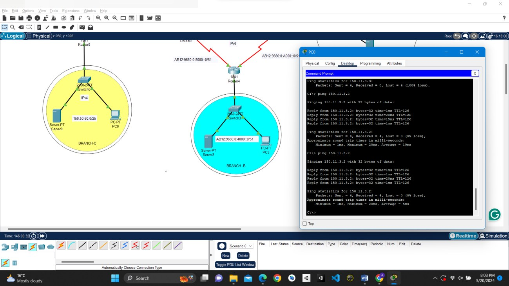
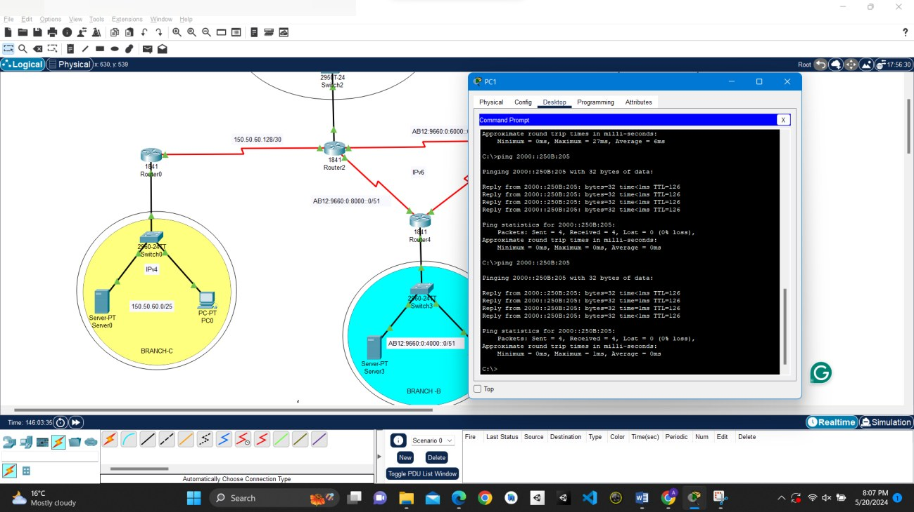
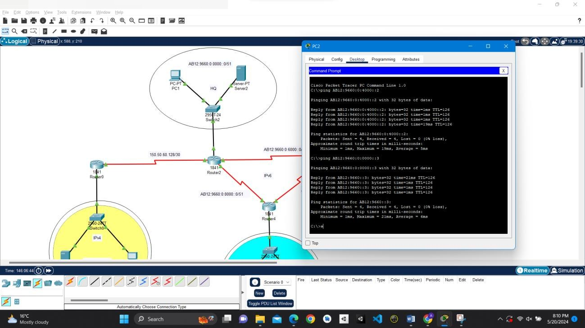
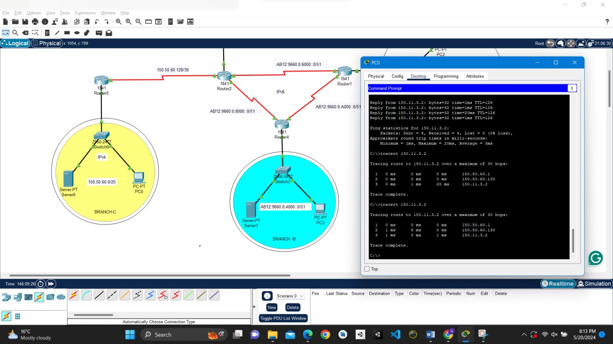
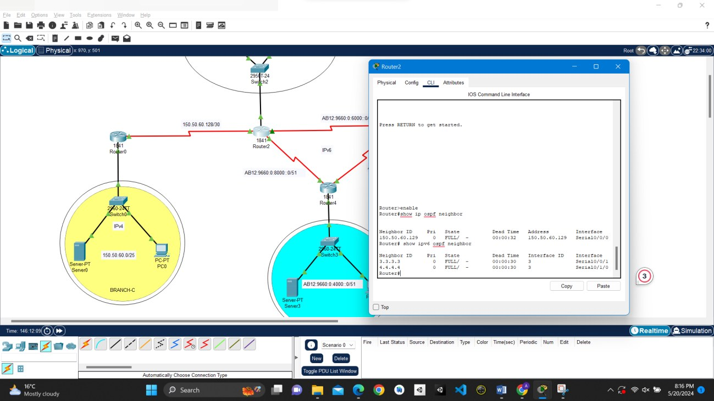
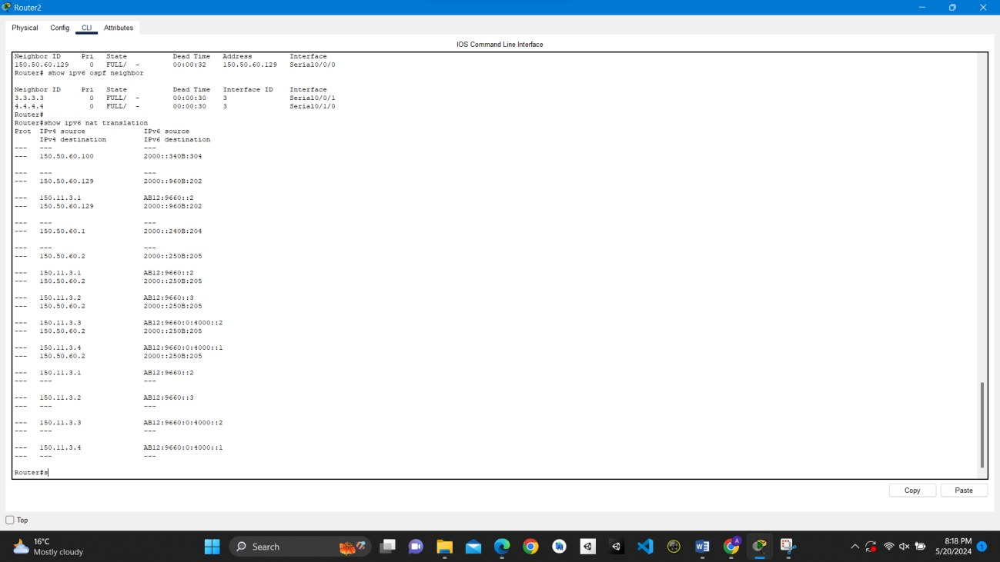

# Lab Summary – IPv6 Migration: OSPFv2/OSPFv3 & NAT-PT

This lab models a company moving to IPv6. HQ and two branches (A and B) run **IPv6 only**, routed with **OSPFv3**. A legacy branch (Branch C) is still **IPv4**, linked to HQ with **OSPFv2**. The HQ router runs **NAT-PT** (IPv6↔IPv4 translation) so IPv6 hosts can reach the IPv4 branch server and the other way round. I worked out the IPv6 subnet plan from a single /48-style block and built and tested everything in Packet Tracer.

> Screenshots are from my own Packet Tracer build. Identifying details (file paths, student and course identifiers) are blurred.

---

## Verification

### Figure 1.1: IPv6 Branch PC → IPv4 Server (via NAT-PT)
**Device:** `Branch PC`

An IPv6 host pings the IPv4 server in Branch C using its mapped IPv6 address. The replies prove the HQ router is translating IPv6 to IPv4.

### Figure 1.2: IPv4 Host → IPv6 Server (via NAT-PT)
**Device:** `Branch-C PC`

The reverse direction: an IPv4 PC reaches the HQ IPv6 server through its static v6→v4 mapping.

### Figure 1.3: IPv6 to IPv6 Across Branches
**Device:** `Branch-A PC`

Pings from Branch A to Branch B and HQ over the IPv6-only WAN links show that OSPFv3 has learned every IPv6 prefix.

### Figure 1.4: Traceroute to Confirm the Path
**Device:** `Branch-C PC`

`tracert` from the IPv4 branch to the HQ server shows the packet path hop by hop through the translating HQ router.

### Figure 1.5: OSPF Neighbours on the HQ Router
**Device:** `HQ Router`

`show ip ospf neighbor` and `show ipv6 ospf neighbor` show **FULL** adjacencies: OSPFv2 with Branch C and OSPFv3 with Branches A and B.

### Figure 1.6: NAT-PT Translation Table
**Device:** `HQ Router`

`show ipv6 nat translations` lists the static v4↔v6 mappings and the active ICMP sessions created by the tests.

